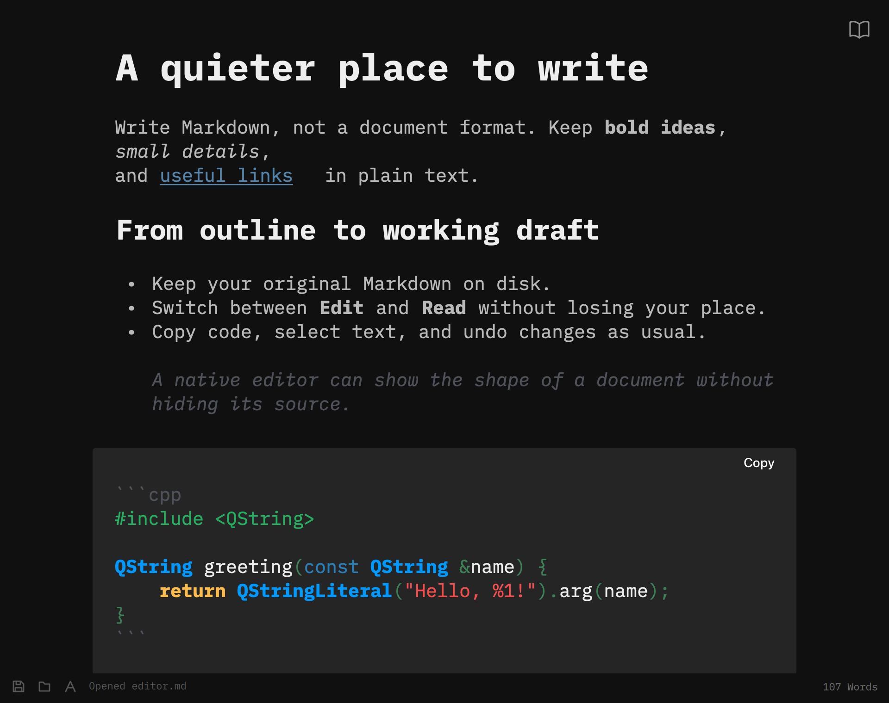

# Write (Omawrite)

A native Markdown writing app built with Qt Quick and C++. Plain-text files,
caret-aware formatting, and a focused writing surface that follows the desktop.



## Writing features

- **Edit and Read:** caret-aware Markdown markers, incremental native previews,
  preserved selections and reading position, ordinary Markdown on disk.
- **Tables:** editable virtualized grids, column alignment, rectangular fill,
  horizontal scrolling, and an expanded view backed by the same table model.
- **Code:** language-aware highlighting, continuous code panels, language labels,
  copying, and local horizontal overflow.
- **References and footnotes:** full/collapsed reference links, numbered footnote
  previews in Edit and Read, hover text, internal footnote navigation, and
  clipboard-aware insertion shortcuts.
- **Images and diagrams:** local images, pasted clipboard screenshots, attachment
  naming/repair/copy commands, and optional Mermaid previews through a local CLI.
- **Desktop integration:** per-document windows, single-instance file routing,
  recoverable drafts, external-change protection, native spelling, and Print/PDF
  snapshots with wide-table appendices.
- **Everyday tools:** translated UI, installed-font picker, zoom, search/replace,
  formatting shortcuts, and rendered HTML/plain-text copying.

See the [screenshot gallery](docs/screenshots/README.md),
[complete writing guide and shortcuts](docs/writing-and-shortcuts.md), and
[enhancement review notes](docs/upstream-review.md).

## Install and build

Published Omarchy installations provide the `omawrite` package. Development
features on this branch are not necessarily available in released packages.

For local builds, use the [dependency and installation guide](docs/install.md).
This branch supports Linux, macOS and Windows; its additional KDE dependencies
and packaging changes require review before distribution.

```sh
./bin/build
./bin/test
```

On Linux: `./build/cmake/omawrite document.md`.
On macOS: `open -a "$PWD/build/cmake/Write.app" document.md`.
`omawrite --help` describes command-line options without opening a window.

Windows x64, from CMD:

```bat
setup.bat -Install -Installer
build.bat --test --installer
```

Installer automation is unsigned. Native installer, printer and dictionary
validation remain separate from automated tests. Mermaid/Node are optional
external tools; Write does not embed a browser. Quit other running Write builds
before testing so file requests do not reach an older instance.

More documentation:
[testing](docs/testing.md) · [preview example](docs/preview-example.md) ·
[code example](docs/code-highlighting-example.md) ·
[spelling example](docs/spellchecking-example.md).

## License and distribution

The application retains its [MIT license](LICENSE) and contributor attribution.
Dependencies/resources have additional terms, including static LGPL relinking
obligations and mixed-license syntax resources. See [copyright and dependency
notices](COPYRIGHT.md). Building or packaging does **not** establish
redistribution clearance; the existing packaging guard remains enabled.
