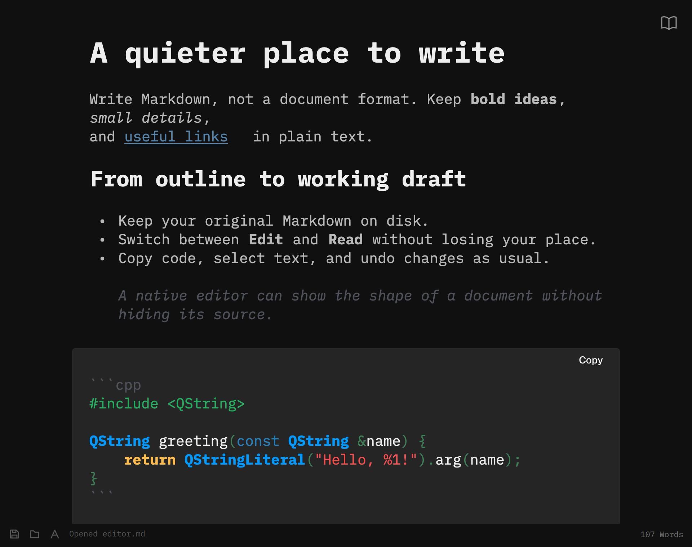
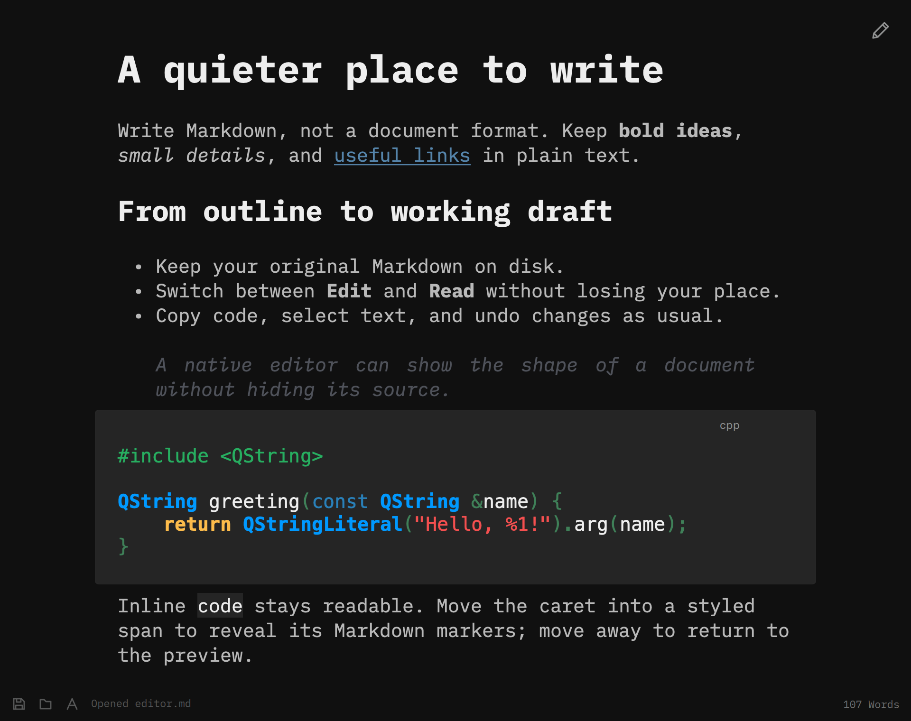
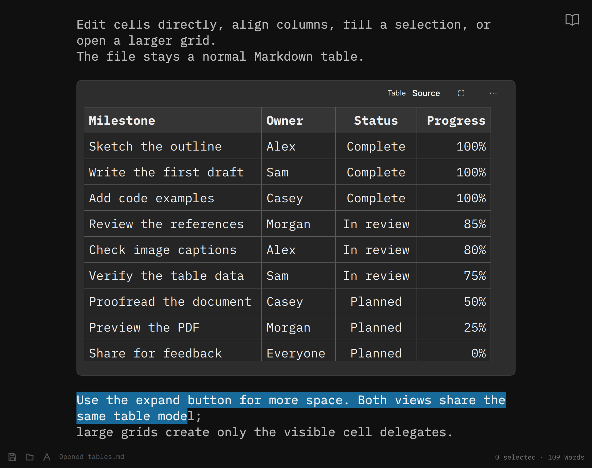
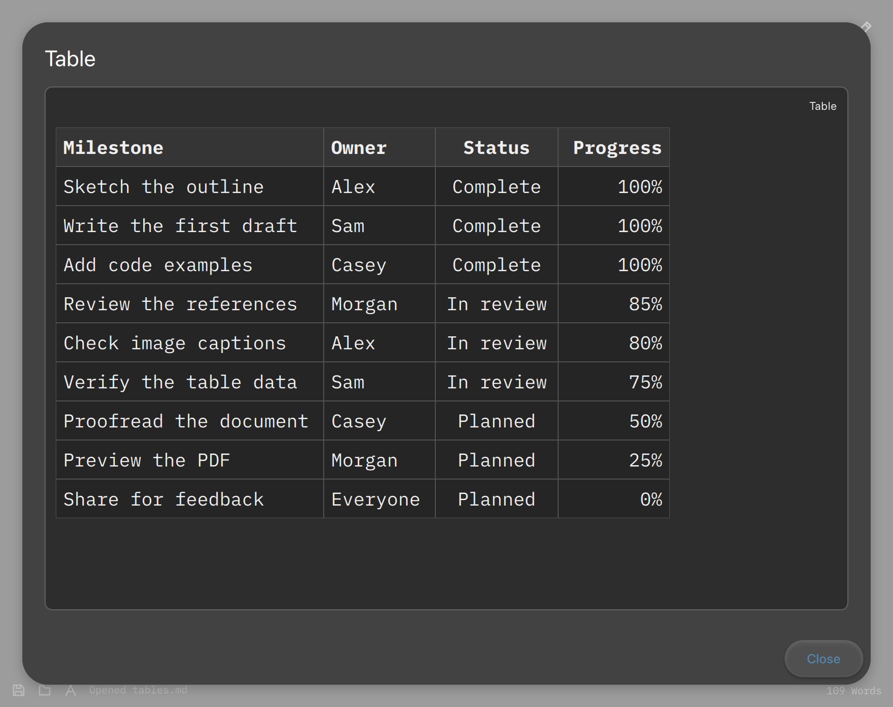
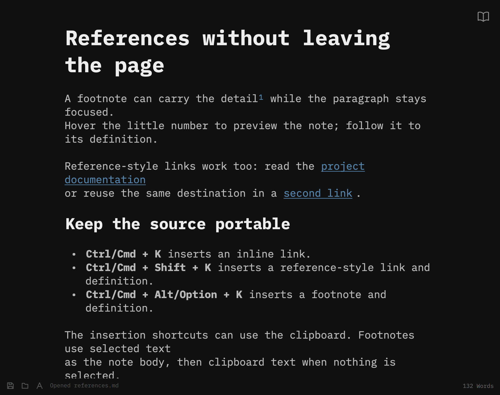
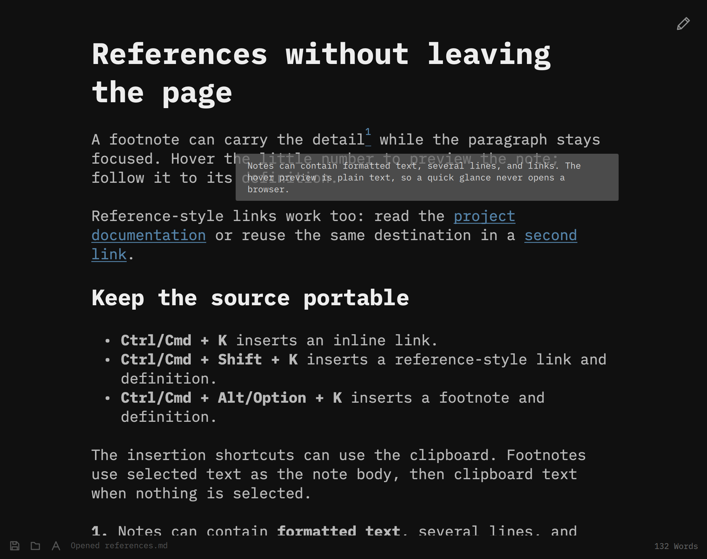
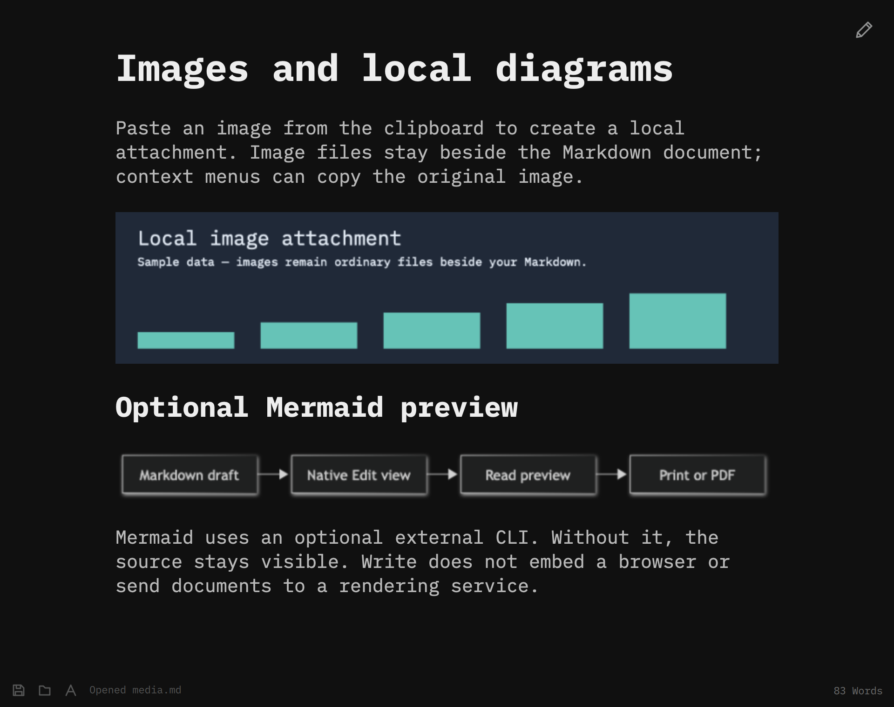

# Feature gallery

Actual Qt-rendered captures of the checked-in example documents. These use
synthetic text and a generated local image, not personal files or clipboard
contents. Captured on macOS with Qt 6.12's native Qt Quick renderer, at
960 × 760 logical pixels (1920 × 1520 on the capture display). These demonstrate
the UI, not printer, installer or cross-platform validation.

## Native Markdown editing

Caret-aware formatting, lists, quotes and syntax-colored code panels. Markdown
remains the canonical document; moving into a styled span reveals its markers.



## Read view

The same source rendered for reading, with language labels and no source rewrite.



## Editable tables

Column alignment, inline editing, source access, overflow and a bounded grid.
Large tables create only the visible delegates.



## Expanded tables

A larger modal view uses the same table model, with Read mode preventing edits.
On short desktops the modal fills the available content area rather than
promising a taller grid than the inline view.



## Footnotes in Edit

Resolved notes become small numbered superscripts outside the active marker.
Definitions remain Markdown; selection and editing reveal the original source.



## Footnote hover preview

Hover previews the note without opening a browser. Following a footnote jumps
to its definition; ordinary reference links still open their URL.



## Images and optional Mermaid

Local image files and asynchronously rendered Mermaid diagrams. The illustrative
chart is generated sample data. Mermaid uses an external CLI; without it the
source is left visible.



System spelling menus, file dialogs, per-document windows and Print/PDF depend
on native platform services and are described in the [user guide](../writing-and-shortcuts.md)
and [review notes](../upstream-review.md), rather than staged as OS screenshots.

## Reproducing the gallery

Build the extended editor test executable using the dependencies in
[the installation guide](../install.md) and `tests/tests.pro`, for example:

```sh
mkdir -p build-tests
(cd build-tests && qmake6 ../tests/tests.pro && make -j6)
```

Then run only the opt-in capture slot:

```sh
OMAWRITE_SCREENSHOT_DIR="$PWD/docs/screenshots" QSG_RENDER_LOOP=threaded \
  ./build-tests/tst_editor capturesDocumentationGallery
```

On macOS replace the executable with
`./build-tests/tst_editor.app/Contents/MacOS/tst_editor`.
The capture test is skipped in ordinary test runs. It opens temporary copies
of the examples and checks that each source document is unchanged, generates
`attachment-example.png`, then saves the seven window captures. It does not read
the clipboard, open your documents or start an OS printer dialog. Tests redirect
preferences and recovery into test storage. Windows are shown without accepting
keyboard focus. For a headless alternative add `QT_QPA_PLATFORM=offscreen` and
`QT_QUICK_BACKEND=software`; some Material shadows/effects will differ.

Install the optional `mmdc` CLI before capturing if the final image should contain
a rendered diagram. Rendering is asynchronous; the capture allows ten seconds,
so unusually slow environments may need a longer wait or a second capture.
Different Qt versions, fonts and display scaling can change pixels; these are
not pixel-test baselines. Review regenerated images before committing them.

## Original upstream screenshots

The existing upstream examples remain available, unchanged:

- [Original light screenshot](https://github.com/user-attachments/assets/4e930c0d-edda-4046-b444-a59eff523329)
- [Original dark screenshot](https://github.com/user-attachments/assets/8ced7c26-961b-4ded-b263-84403001a951)
