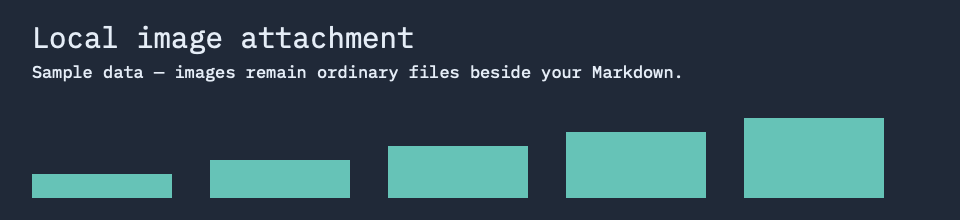
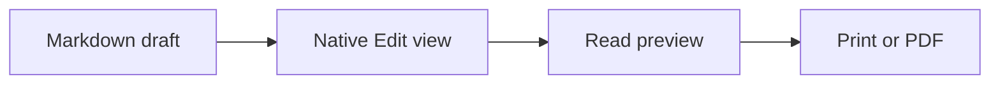

# Images and local diagrams

Paste an image from the clipboard to create a local attachment. Image files
stay beside the Markdown document; context menus can copy the original image.

## Optional Mermaid preview

Mermaid uses an optional external CLI. Without it, the source stays visible.
Write does not embed a browser or send documents to a rendering service.
